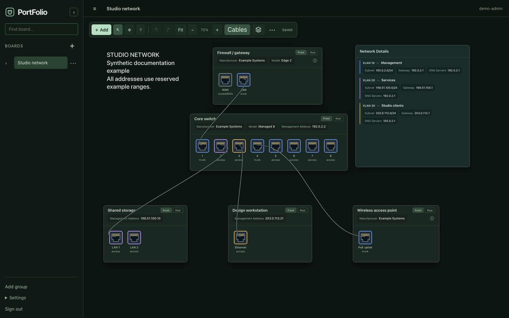
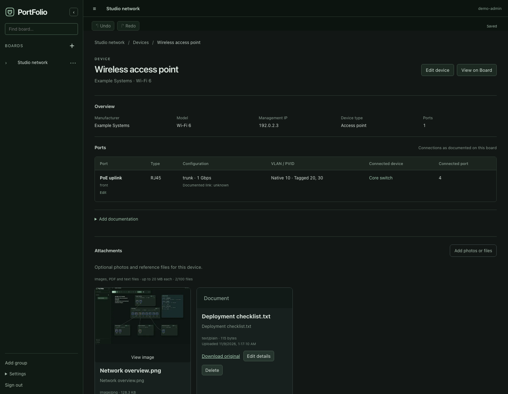

# PortFolio

**Visual Network Documentation**

Build a clear picture of your network: arrange equipment on a freeform board, document its ports and VLANs, and draw the physical connections between them. PortFolio is self-hosted, stores your work locally, and runs without a cloud account.



[Install](docs/INSTALLATION.md) · [MCP integration](docs/MCP.md) · [Security](docs/SECURITY.md) · [Releases](https://github.com/ryanonmars/PortFolio/releases) · [Contributing](docs/CONTRIBUTING.md)

## Your documentation, on a board

- **Arrange equipment freely.** Move and resize devices and network containers, add text and shapes, and organize standalone boards into optional groups.
- **Document the physical detail.** Place RJ45, SFP, SFP+, QSFP, and custom ports on front or rear faces. Use port layout presets, copy settings between ports, and connect stable port identities with cables.
- **Keep network information flexible.** Record VLANs, addresses, DHCP ranges, notes, and custom fields without a required setup sequence. VLAN Spotlight highlights documented memberships.
- **Look beyond the canvas.** Device and individual VLAN Detail Pages hold reference information, photos, PDFs, and text files. Linked summaries stay synchronized with devices.
- **Work directly.** Contextual inspectors autosave, while pan, zoom, snapping, multi-selection, and undo/redo support editing on desktop and mobile.
- **Keep a portable copy.** Export editable board JSON or an SVG image. Complete application backups also preserve attachments and account data.



PortFolio documents what you enter. It does not scan networks, monitor equipment, configure devices, or infer live link status. Link states are labeled as documented; colors describe your records.

## Run with Docker

The published image supports Linux **amd64** and **arm64**. Docker Engine with Compose v2 is required.

```sh
mkdir portfolio && cd portfolio
curl -fsSLO https://raw.githubusercontent.com/ryanonmars/PortFolio/v0.4.0/deployment/compose.yaml
curl -fsSL https://raw.githubusercontent.com/ryanonmars/PortFolio/v0.4.0/deployment/.env.example -o .env
```

Set `DATA_PATH` in `.env` to an absolute path for your persistent data. On Linux, create it with the runtime user's ownership; the default is `1000:1000`:

```sh
sudo install -d -m 0700 -o 1000 -g 1000 /absolute/path/to/portfolio-data
```

Then start PortFolio:

```sh
docker compose pull
docker compose up -d --wait
```

Open **http://localhost:3088** on the host, or use the server's private IP or local hostname. Create the administrator account on first use; there are no default credentials. The supplied stack binds port 3088 on all host interfaces. Set `BIND_ADDRESS=127.0.0.1` for access from the host only.

The stack pins `ghcr.io/ryanonmars/portfolio:v0.4.0` and keeps SQLite, attachments, and backups in the directory mounted at `/data`. See [installation and recovery](docs/INSTALLATION.md) for TrueNAS/Dockge, source builds, HTTPS, updates, and troubleshooting.

## Author boards with an agent

The optional local **MCP server** gives an MCP-capable agent two workflows:

- **Offline:** generate and validate an editable board JSON file, then import it yourself. No API URL, token, or running PortFolio instance is needed.
- **Connected:** read saved boards and apply explicitly reviewed changes through a scoped API token. Validation precedes new-board creation; existing-board edits use version checks.

Your agent reads source documents using its own authorized tools. PortFolio does not include an LLM, Excel/PDF parser, or MCP filesystem tools. See the [MCP setup guide](docs/MCP.md) for the downloadable adapter, CLI, tool reference, and approval flow.

## Downloads and development

Get the [v0.4.0 release](https://github.com/ryanonmars/PortFolio/releases/tag/v0.4.0), [release notes](docs/releases/v0.4.0.md), or the [published container](https://github.com/ryanonmars/PortFolio/pkgs/container/portfolio). The release includes the standalone Node24 MCP adapter; source installation is documented in [INSTALLATION.md](docs/INSTALLATION.md#run-from-source).

The application uses React, TypeScript, Fastify, and SQLite. See [CONTRIBUTING.md](docs/CONTRIBUTING.md) for local development and validation commands.

## Architecture

The React/TypeScript editor saves canonical board documents through the Node.js/Fastify API. SQLite stores application records; uploaded files remain beside it under the persistent data directory. The optional MCP adapter is a separate local stdio process: it generates import JSON offline or calls the authenticated API in connected mode. Docker packages the application; GitHub Actions tests each release and publishes versioned images and MCP downloads.

## License

No license file is currently included in this repository.
